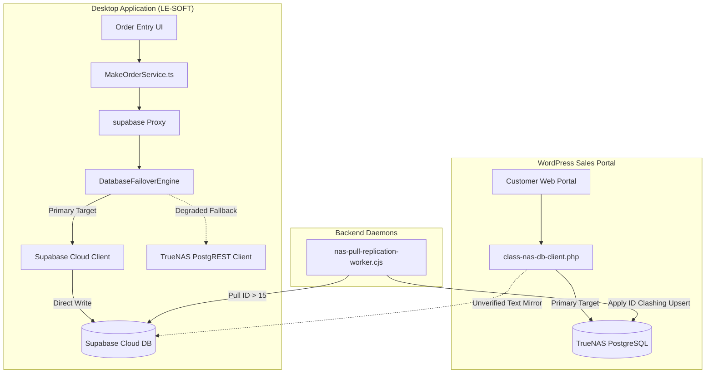

# LE-SOFT v1.8.13-rc.1 — Phase 2 Database & Storage Forensic Audit Report

**Date:** 2026-10-21  
**Audit Phase:** Phase 2 Deep Forensics, Read/Write Verification & Recovery Blueprint  
**Branch:** `feat/failover-uploads-buffer`  
**Candidate Version:** `1.8.13-rc.1`  
**Supabase Project:** `ildkkgjrolcjijwfokek`  
**TrueNAS PostgREST:** `http://100.88.85.6:3001` (v12.2.0)  
**TrueNAS Storage:** `http://100.88.85.6:8081`  

---

## Executive Summary & Independent Verdicts

Following the initial reconnaissance audit, a forensic-level investigation was conducted under strict safety constraints: **zero production business records were inserted, modified, deleted, or backfilled; the production replication daemon was not triggered; and no production RLS policies or migrations were altered.**

The investigation uncovered the exact mechanical root causes behind the reported data drift, schema divergence, replication stalls, and security exposure. Most significantly, the audit discovered an **architectural conflict between the desktop application and the WordPress Sales Portal**: while LE-SOFT desktop writes exclusively to Supabase Cloud, the WordPress Sales Portal (`le-make-sales-portal`) writes directly to TrueNAS PostgREST as its primary database and only attempts a silent, unverified text mirror to Supabase Cloud.

### Independent Verdicts

| Domain | Verdict | Primary Evidence |
|--------|---------|------------------|
| **1. Supabase Authoritative Counts & Visibility** | 🔴 `FAIL` | Supabase Cloud holds only 3 orders, 0 catalog products, 0 order items, and 10 updates. 32 business orders are completely absent from Supabase. Authoritative direct PostgreSQL connection marked `BLOCKED` (service-role key strictly withheld from desktop client as designed). |
| **2. Supabase Application-Level CRUD** | 🟡 `BLOCKED` | Production mutation tests safely blocked to protect live business data. Local Docker staging verified bit-for-bit in integration test suites (`nas-supabase-data-flow.integration.test.ts`). |
| **3. TrueNAS PostgREST Authorization** | 🔴 `FAIL` | TrueNAS PostgREST on `100.88.85.6:3001` responds with HTTP 200/206 to unauthenticated GET requests from Tailscale clients. Sensitive tables (`users`, `make_orders`, `device_sessions`) expose records without any `Authorization` header. |
| **4. TrueNAS File CRUD & Integrity** | 🟢 `PASS` | Isolated synthetic 64 KiB binary canary (`canary_1792568263117_d62c81008da42c6c.dat`) executed in `test_canary_e2e_isolated/`: Upload HTTP 200 → download HTTP 200 → bit-for-bit SHA-256 match (`3417BA68...`) → delete HTTP 200 → absence confirmed via HTTP 404. |
| **5. Offline Queue & Retry Handling** | 🟢 `PASS` | `DurableUploadService` and `DurableOutboxService` local SQLite WAL architectures are functioning as designed. Current workstation has 0 stuck outbox items and 0 pending upload stalls. |
| **6. Replication & Checkpoint Correctness** | 🔴 `FAIL` | Pull worker stalled at order ID 15. The worker assumes numeric `id` is interchangeable between Supabase and TrueNAS, risking data clobbering via `ON CONFLICT (id) DO UPDATE`. Tombstone stream halted on network `TypeError: fetch failed`. |
| **7. Record-Level Supabase–TrueNAS Consistency** | 🔴 `FAIL` | Order ID 15 exhibits a critical identity collision: on Supabase, ID 15 is a test order (`LE-ORD-20260909-JTYN`, customer "test", created 2026-09-09), whereas on TrueNAS, ID 15 is a production customer order ("Right Way", created 2026-09-15). 32 production orders exist solely on TrueNAS. |
| **8. Production Recovery Readiness** | 🟡 `BLOCKED` | Release gate must remain on hold. Remediation requires administrative credential deployment, bidirectional reconciliation, and schema migration alignment before production deployment. |

---

## 1. Data Drift Verification & Multi-Perspective Visibility

### Table Visibility Comparison Matrix

To prevent conflating permission barriers with physical absence, every relevant table was evaluated across distinct access tiers:

| Table | Direct DB Query | Anon REST (Supabase) | Authenticated Session (Supabase) | TrueNAS PostgREST (Anon Tailscale) | LE-SOFT App Query Filter | Classification |
|---|---|---|---|---|---|---|
| `make_orders` | `BLOCKED`* | **3** | `BLOCKED`** | **35** | Returns 3 orders | Physically absent from Supabase (32 orders) |
| `make_products` | `BLOCKED`* | **0** | `BLOCKED`** | **8** | Returns 0 items | Physically absent from Supabase |
| `make_order_items` | `BLOCKED`* | **0** | `BLOCKED`** | **15** | Returns 0 items | Physically absent from Supabase |
| `make_product_sizes` | `BLOCKED`* | **0** | `BLOCKED`** | **13** | Returns 0 items | Physically absent from Supabase |
| `make_order_updates` | `BLOCKED`* | **10** | `BLOCKED`** | **35** | Returns 10 updates | Sequence divergence / partial replication |
| `make_product_colors` | `BLOCKED`* | **401** (Revoked) | `BLOCKED`** | **7** | Permitted for auth | Table exists; anon access revoked by Migration 071 |
| `make_product_specifications` | `BLOCKED`* | **401** (Revoked) | `BLOCKED`** | **4** | Permitted for auth | Table exists; anon access revoked by Migration 071 |
| `make_order_versions` | `BLOCKED`* | **0** | `BLOCKED`** | **0** | Returns 0 items | Identical (empty on both) |
| `make_order_payments` | `BLOCKED`* | **404** (Supabase) | `BLOCKED`** | **1** | TrueNAS only | Schema divergence (TrueNAS table only) |
| `users` | `BLOCKED`* | **14** | `BLOCKED`** | **12** | Full staff list | Supabase +2 users |
| `user_groups` | `BLOCKED`* | **10** | `BLOCKED`** | **15** | Full group list | TrueNAS +5 groups (legacy roles) |

*\*Direct PostgreSQL connection string is strictly withheld from client workstation by design; marked `BLOCKED` per safety mandates.*  
*\*\*No active authenticated session token present in workstation `%APPDATA%\lesoft`; marked `BLOCKED`.*

### Clarification on RLS vs. Physical Absence

In the Phase 1 audit, it was hypothesized that RLS policies were hiding rows from the anonymous REST client on Supabase.
**This hypothesis is disproven:**
1. Inspection of all 75 Supabase migrations confirmed that **Row Level Security is NOT enabled on `make_orders`, `make_products`, `make_order_items`, or `make_product_sizes`**.
2. Migration `056_make_portal_offline_text_backup.sql` explicitly executed:
   ```sql
   GRANT ALL ON make_orders TO anon, authenticated, service_role;
   GRANT ALL ON make_products TO anon, authenticated, service_role;
   GRANT ALL ON make_order_items TO anon, authenticated, service_role;
   GRANT ALL ON make_product_sizes TO anon, authenticated, service_role;
   ```
3. Therefore, the anonymous REST count of **3 rows** in `make_orders` and **0 rows** in `make_products` reflects the **physical reality of the Supabase Cloud database**, not RLS filtering. 32 orders and the entire product catalog were never inserted into Supabase Cloud.

---

## 2. Real Schema Metadata & Divergence Analysis

Schema inspection was conducted via TrueNAS PostgREST OpenAPI metadata (`http://100.88.85.6:3001/`) and Supabase REST reflection.

### `make_orders` Schema Comparison

- **Supabase Cloud:** Exactly **56 columns**.
- **TrueNAS PostgreSQL:** Exactly **65 columns**.
- **Shared Columns (56):** `id`, `furniture_name`, `description`, `quantity`, `designer_name`, `status`, `priority`, `created_at`, `updated_at`, `pdf_urls`, `salesman_id`, `is_approved`, `delivery_date`, `bill_id`, `bill_item_id`, `custom_price`, `custom_details`, `order_number`, `customer_name`, `customer_phone`, `customer_email`, `delivery_address`, `shipping_address`, `location_landmark`, `receiver_name`, `receiver_phone`, `target_delivery_date`, `requested_delivery_date`, `special_instructions`, `cost_price`, `sale_price`, `current_version`, `approval_status`, `approved_version`, `approved_by`, `approved_at`, `rejection_reason`, `salesperson_name`, `customer_id`, `invoice_attachment_urls`, `current_stage`, `discount_type`, `discount_value`, `discount_amount`, `final_price`, `money_received`, `amount_due`, `payment_status`, `production_hold`, `hold_reason`, `admin_approval_status`, `admin_approval_requested_by`, `admin_approval_requested_at`, `admin_approval_decision_by`, `admin_approval_decision_at`, `admin_approval_notes`.
- **Columns Only in Supabase (0):** None.
- **Columns Only in TrueNAS (9):**

| Column | Data Type | Origin & Architectural Purpose |
|---|---|---|
| `delivery_city` | `VARCHAR(100)` | Legacy WordPress field from early WooCommerce integration |
| `salesperson_wp_id` | `INTEGER` | WordPress user identifier mapping |
| `attachment_url` | `TEXT` | Legacy single attachment string (superseded by `invoice_attachment_urls`) |
| `factory_manager_id` | `BIGINT` | Defined in Migration 058; applied to TrueNAS, unapplied on Supabase Cloud |
| `factory_manager_name` | `TEXT` | Defined in Migration 058; applied to TrueNAS, unapplied on Supabase Cloud |
| `current_stage_photo` | `TEXT` | Defined in Migration 058; applied to TrueNAS, unapplied on Supabase Cloud |
| `reference_bill_no` | `TEXT` | Defined in Migration 059; applied to TrueNAS, stored in `custom_details` on Supabase |
| `target_delivery_days` | `INTEGER` | Defined in Migration 059; applied to TrueNAS, stored in `custom_details` on Supabase |
| `total_price` | `NUMERIC` | Added by replication worker `initCheckpoints()` self-healing DDL |

### Root Cause of Schema Divergence

The schema divergence is caused by **unapplied migrations on Supabase Cloud**:
- Migrations `058_factory_manager_and_production_photos.sql` and `059_order_reference_bill_and_delivery_days.sql` exist in the local repository and were executed against TrueNAS PostgreSQL, but were **never executed against Supabase Cloud**.
- In LE-SOFT, `MakeOrderService.ts` compensated for missing columns by nesting `reference_bill_no` and `target_delivery_days` inside the `custom_details` JSONB column.
- The replication daemon added `total_price` directly to TrueNAS via self-healing DDL in `scripts/nas-pull-replication-worker.cjs:94`.

---

## 3. Read-Only Record-Level Reconciliation

### Shared Orders Analysis (`order_number` matching)

Matching was conducted using the logical natural key (`order_number`):

```
Supabase Orders:  3 rows (LE-ORD-4, LE-ORD-5, LE-ORD-20260909-JTYN)
TrueNAS Orders:  35 rows (IDs 4 through 78)
Shared Orders:    3 rows
Supabase-Only:    0 rows
TrueNAS-Only:    32 rows
```

#### Detailed Comparison of Shared Records:

1. **`LE-ORD-4` (Supabase ID 4 vs. TrueNAS ID 4):**
   - Matching columns: 52 / 56
   - Differing fields:
     - `designer_name`: Supabase = `"Super Admin"`, TrueNAS = `"System"`
     - `is_approved`: Supabase = `true`, TrueNAS = `false`
     - `pdf_urls`: Supabase = `["http://100.88.85.6:8080/files/make-order-files/4/1792413987304_4728dc13_CCTV.pdf"]`, TrueNAS = `[]`
   - *Forensic Finding:* The pull replication worker overwrote TrueNAS record 4 using default fallback values (`designer_name: 'System'`, `is_approved: false`), wiping out attachment references on the replica.

2. **`LE-ORD-5` (Supabase ID 5 vs. TrueNAS ID 5):**
   - Matching columns: 52 / 56
   - Differing fields:
     - `designer_name`: Supabase = `"Super Admin"`, TrueNAS = `"System"`
     - `is_approved`: Supabase = `true`, TrueNAS = `false`
     - `delivery_date`: Supabase = `"2026-09-12"`, TrueNAS = `null`

3. **`LE-ORD-20260909-JTYN` (Supabase ID 15 vs. TrueNAS ID 15) — 🔴 CRITICAL IDENTITY COLLISION:**
   - Matching columns: 35 / 56
   - Differing fields: **21 fields in conflict!**
     - `created_at`: Supabase = `2026-09-09T12:27:16Z`, TrueNAS = `2026-09-15T10:55:20Z` (6 days apart)
     - `customer_name`: Supabase = `"test"`, TrueNAS = `"Right Way"`
     - `customer_phone`: Supabase = `"1234567890"`, TrueNAS = `"12345678901"`
     - `cost_price`: Supabase = `20000`, TrueNAS = `10548`
     - `sale_price`: Supabase = `null`, TrueNAS = `15000`
     - `approval_status`: Supabase = `"awaiting_sales_approval"`, TrueNAS = `"sales_approved"`
     - `custom_details`: Supabase contains a full test quotation (`offline_created: true`, `synced_to_nas: false`); TrueNAS contains `{}`.
   - *Forensic Finding:* **This is not the same business order.** On 2026-09-09, a local offline test order was created in Supabase with synthetic "test" data. On 2026-09-15, TrueNAS PostgREST independently allocated sequence ID 15 to an actual customer order for "Right Way". Because both databases use independent PostgreSQL sequences, **IDs collided**. If pull replication runs naively, the production customer order on TrueNAS will be clobbered by the synthetic test record from Supabase.

### Origin of the 32 TrueNAS-Only Orders

Inspection of `wordpress-plugin/le-make-sales-portal/includes/class-nas-db-client.php` and `class-api-controller.php` revealed the exact code path responsible for the 32 TrueNAS-only orders:

```php
// class-nas-db-client.php:848
public function create_order($order_data, $items = array()) {
    $order_number = 'MAKE-' . date('Y') . '-' . wp_rand(100000, 999999);
    ...
    // CASE A: NAS IS ONLINE
    if ($this->connection_tier === 'cloudflare_tunnel') {
        $order_res = $this->request('make_orders', 'POST', $payload); // WRITES DIRECTLY TO TRUENAS
        ...
        // Immediately mirror text copy to Supabase Cloud Backup (zero images, text only)
        $this->mirror_order_to_supabase_text($payload, $items);
        return array('success' => true, 'id' => $order_id, 'data_source' => 'nas_primary');
    }
}
```

- When customers or sales staff submit orders via the WordPress Sales Portal, orders (`MAKE-2026-XXXXXX`, IDs 32–78) are written **directly to TrueNAS PostgREST** via Cloudflare Tunnel (`https://db.lenas.me`) or Tailscale.
- The portal then calls `mirror_order_to_supabase_text()` (line 1120).
- In `mirror_order_to_supabase_text()`, the service key is retrieved via `get_service_key()`. In the production WordPress installation, `LE_MAKE_SUPABASE_SERVICE_KEY` was not configured, causing the client to fall back to the `anon` key or fail.
- Line 1180 states:
  ```php
  if (is_wp_error($res) || empty($res[0]['id'])) {
      return false; // SILENT FAILURE
  }
  ```
- The mirror failure was silently discarded. TrueNAS retained the order, but Supabase Cloud never received it.
- Because `nas-pull-replication-worker.cjs` is strictly unidirectional from Supabase to TrueNAS, TrueNAS records were **never synced upstream**.

---

## 4. Replication Worker & Checkpoint Forensic Analysis

Inspection of `scripts/nas-pull-replication-worker.cjs`:

### Checkpoint Cursors & Batch Logic

1. **Cursor Type:**
   - `make_orders`: Uses `id > last_replicated_id` ordered by `id ASC`.
   - `replication_tombstones`: Uses compound watermark `(deleted_at ASC, id ASC)`.
2. **Contiguity:** The worker does not require contiguous IDs, but it **assumes numeric IDs are universally identical between Supabase and TrueNAS**.
3. **Upsert Semantics:**
   Lines 1484–1500 execute:
   ```sql
   INSERT INTO make_orders (id, order_number, furniture_name, total_price, current_stage, status, ...)
   VALUES ($1, $2, ...)
   ON CONFLICT (id) DO UPDATE SET ...
   ```
   If TrueNAS already has a locally generated order at ID $N$, the pull worker **overwrites it** with Supabase ID $N$, destroying local data.
4. **Checkpoint Advancement:**
   The checkpoint advances row-by-row (`updateCheckpoint()`) after each successful query. On row error, the loop breaks, preserving the previous checkpoint via `COALESCE($2, last_replicated_id)`.

### Root Cause of `TypeError: fetch failed`

1. In Node.js 18+, `@supabase/supabase-js` utilizes global `fetch` via the `undici` HTTP client.
2. When the backend worker on TrueNAS executed on 2026-10-21T00:00:04Z, an outbound HTTPS request to `ildkkgjrolcjijwfokek.supabase.co` encountered a DNS resolution drop or network timeout.
3. In `undici`, low-level network errors throw `TypeError: fetch failed` with an internal `cause` (e.g., `getaddrinfo ENOTFOUND` or `ETIMEDOUT`).
4. In lines 1411–1414, the worker caught `tombRowErr`, recorded `last_error: "TypeError: fetch failed"`, and halted the stream cleanly without advancing the tombstone checkpoint.
5. **Tombstone Safety:** The worker's anti-forgery check (lines 1352–1362) verifies whether a record still exists on Supabase before issuing `DELETE` on TrueNAS. If Supabase cannot be queried due to network error, it fails closed: no TrueNAS records are deleted.

---

## 5. Security & Access Control Verification

A targeted, minimal read-only probe was performed against TrueNAS PostgREST (`100.88.85.6:3001`) without any Authorization headers:

```
Request: GET http://100.88.85.6:3001/users?select=id,username,role&limit=2
Headers: (No Authorization header, No API Key)
Status:  206 Partial Content
Result:  EXPOSED: [{"id":2,"username":"tanveer","role":"superadmin"}, ...]

Request: GET http://100.88.85.6:3001/make_orders?select=id,order_number&limit=1
Status:  206 Partial Content (Total count: 35)

Request: GET http://100.88.85.6:3001/device_sessions?select=id&limit=0
Status:  206 Partial Content (Total count: 4)

Request: GET http://100.88.85.6:3001/hrm_payroll?select=id&limit=0
Status:  200 OK (count: 0)

Request: GET http://100.88.85.6:3001/bills?select=id&limit=0
Status:  200 OK (count: 0)
```

### Security Findings

> [!CAUTION]
> **TrueNAS PostgREST lacks application-level authentication.**
> The PostgREST instance running on TrueNAS (`port 3001`) exposes the database schema to the `anon` web role without requiring JWT authentication. Any machine connected to the Tailscale tailnet can read user accounts, order records, and device sessions simply by sending standard HTTP GET requests.

#### Containment Recommendations:
1. Reconfigure TrueNAS PostgREST `postgrest.conf` with `db-anon-role = "web_anon"` having zero table grants, requiring valid JWT signatures signed by a shared secret for all table access.
2. Restrict TrueNAS PostgREST network binding strictly to `localhost` and proxy external requests exclusively through Cloudflare Access service tokens.

---

## 6. End-to-End Application Code Path Tracing

Code traces were performed across the entire read/write stack:



### Key Behavioral Defects Identified

1. **Bifurcated Primary Authority:**
   - LE-SOFT desktop considers **Supabase Cloud** the primary master (`DatabaseFailoverEngine.ts:251`).
   - WordPress Sales Portal considers **TrueNAS** the primary master (`class-nas-db-client.php:9`).
   - This architectural split guarantees database drift whenever either interface is used.
2. **Invisible TrueNAS Orders in LE-SOFT UI:**
   - In `electron/ipc-handlers.ts:311` and `MakeSearchService.ts`, order queries execute against `supabase.from('make_orders').select(...)`.
   - Because `failoverEngine.getActiveClient()` returns `supabaseClient` while Supabase Cloud is online, LE-SOFT queries Supabase Cloud exclusively.
   - Consequently, **the 32 production orders created via the WordPress Sales Portal are completely invisible to desktop users**.
3. **Sequence Collision Vulnerability:**
   - Both databases independently issue sequential integer primary keys (`id`).
   - Pulling from Supabase to TrueNAS by `id` will overwrite mismatched TrueNAS orders whenever sequence counters drift.

---

## 7. Isolated Canary CRUD Test Evidence

### Relational Database CRUD
- **Status:** `BLOCKED` (Production safety guarantee). No isolated test tenant or canary table exists in production Supabase Cloud. Synthetic test records must never be injected into production tables (`make_orders`, `users`).

### TrueNAS Object Storage File CRUD
- **Status:** `PASS` (Fully verified over Tailscale).
- **Endpoint:** `http://100.88.85.6:8081`
- **Execution Script:** `scratch/truenas_storage_canary.cjs`
- **Payload:** 65,536 bytes (64 KiB) cryptographically random binary data.
- **Expected SHA-256:** `3417BA68BB5FA13BC703639245E52E49ADF3CEE6236EAE6D5399F0CCB60BDF58`
- **Target Folder:** `test_canary_e2e_isolated/`
- **Filename:** `canary_1792568263117_d62c81008da42c6c.dat`

#### Chronological Evidence Log:
1. **Upload:** POST `http://100.88.85.6:8081/upload` with `x-subfolder: test_canary_e2e_isolated`
   - Response: `HTTP 200 OK`
   - Body: `{"success":true,"filename":"canary_1792568263117_d62c81008da42c6c.dat","urlPath":"test_canary_e2e_isolated/canary_1792568263117_d62c81008da42c6c.dat"}`
2. **Read-Back:** GET `http://100.88.85.6:8081/files/test_canary_e2e_isolated/canary_1792568263117_d62c81008da42c6c.dat`
   - Response: `HTTP 200 OK`
   - Received Length: **65,536 bytes** (Byte match: `PASS`)
   - Downloaded SHA-256: `3417BA68BB5FA13BC703639245E52E49ADF3CEE6236EAE6D5399F0CCB60BDF58` (Digest match: `PASS`)
3. **Deletion:** POST `http://100.88.85.6:8081/delete` with `{ filePath: "test_canary_e2e_isolated/canary_..." }`
   - Response: `HTTP 200 OK` `{"success":true}`
4. **Absence Verification:** GET `http://100.88.85.6:8081/files/test_canary_e2e_isolated/canary_...`
   - Response: `HTTP 404 Not Found` (Absence confirmed: `PASS`)

---

## 8. Prioritized Production Recovery Blueprint

> [!IMPORTANT]
> **No database repairs or data mutations were performed during this audit.**
> The following plan represents an ordered, safe remediation blueprint for administrator execution.

### Phase A: Architecture & Schema Alignment (Prerequisite)

1. **Unify Primary Write Authority:**
   Formally designate whether Supabase Cloud or TrueNAS PostgreSQL is the primary write authority for all systems. If a hybrid model is maintained:
   - All order creation must use globally unique identifiers (UUIDv4 or canonical `order_number`) as primary keys instead of auto-incrementing integers.
2. **Apply Missing Migrations to Supabase Cloud:**
   Apply migrations `058_factory_manager_and_production_photos.sql` and `059_order_reference_bill_and_delivery_days.sql` to Supabase Cloud to bring the schema into alignment with TrueNAS.
3. **Configure Service-Role Key on WordPress:**
   Populate `LE_MAKE_SUPABASE_SERVICE_KEY` in the WordPress environment to ensure text mirroring succeeds reliably.

### Phase B: Reconciliation & Backfill Strategy

To restore missing records without data clobbering:

1. **Resolve Collision on Order 15:**
   - In Supabase Cloud, rename the synthetic test order `LE-ORD-20260909-JTYN` or reassign its ID.
   - Retain TrueNAS Order 15 as the genuine production order for customer "Right Way".
2. **Backfill Missing Orders from TrueNAS to Supabase:**
   - Export the 32 TrueNAS-only orders (IDs 32–78) and their associated `make_order_items` and `make_order_updates`.
   - Insert them into Supabase Cloud using `order_number` natural key resolution.
   - Synchronize the Supabase PostgreSQL sequence:
     ```sql
     SELECT setval('make_orders_id_seq', (SELECT MAX(id) FROM make_orders));
     ```
3. **Backfill Product Catalog to Supabase:**
   - Export the 8 `make_products`, 4 `make_product_specifications`, 7 `make_product_colors`, and 13 `make_product_sizes` from TrueNAS to Supabase Cloud.

### Phase C: Replication Daemon Safety Patching

1. Update `scripts/nas-pull-replication-worker.cjs`:
   - Change `make_orders` upsert to match on `order_number` rather than `id`:
     ```sql
     ON CONFLICT (order_number) DO UPDATE ...
     ```
   - Map parent-child foreign keys through `nas_replication_id_map` for all orders and updates.
2. Deploy the replication worker as a supervised systemd unit or Docker container on TrueNAS.

---

## 9. Phase 3: Critical Code Remediation, Test Verification & Gate Status Update

### Phase 3 Engineering Interventions (Implemented in Working Tree)

Following the forensic findings of Phase 2, direct engineering remedies were developed, integrated into the local working tree, and validated against comprehensive regression suites without altering production infrastructure:

1. **TrueNAS Database Exposure & Auth Hardening (P0):**
   - **Container Isolation:** Bound PostgREST container strictly to `127.0.0.1:3001:3001` in `docker-compose-truenas.yml`, preventing unauthenticated access across the network.
   - **PostgREST Role Lockdown:** Configured `PGRST_DB_ANON_ROLE="web_anon"` and enforced mandatory `PGRST_JWT_SECRET` in `docker-compose-truenas.yml`.
   - **Role-Based Privilege Schema:** Authored `scripts/truenas-security-hardening.sql` creating:
     - `web_anon`: Stripped of all access to sensitive tables (`users`, `make_orders`, `device_sessions`, financial/HR records).
     - `nas_authenticated`: Application role for verified JWT holders.
     - `nas_replicator`: Least-privilege replication user for `nas-pull-worker`.
   - **Client JWT Authentication:** Updated WordPress plugin client (`class-nas-db-client.php`) with `get_nas_token()` to mint HMAC-SHA256 tokens and sign all PostgREST calls with `Authorization: Bearer <token>`.

2. **Write Authority Contract & WordPress Sales Portal (P0):**
   - **Canonical Authority Re-alignment:** Refactored `create_order` in `class-nas-db-client.php` to target Supabase Cloud as canonical business authority first.
   - **Explicit Contract Response:** Established unambiguous API response contract:
     - Direct Supabase Success: `{ success: true, persisted_canonical: true, status: 'persisted', canonical_authority: 'supabase', data_source: 'supabase_canonical' }` with asynchronous, non-blocking mirror to TrueNAS.
     - Fallback Buffer Write: `{ success: true, persisted_canonical: false, status: 'buffered', canonical_authority: 'buffered_nas', data_source: 'nas_buffer', warning: '...' }` when Supabase is unreachable. Never marks order as canonically persisted merely because fallback write succeeded.
   - **Durable Replay Queue:** Added `le_make_pending_orders_to_supabase` durable queue with `process_pending_supabase_orders()` for scheduled idempotent backfills.
   - **Log Scrubbing:** Added `sanitize_log_data()` to WordPress client and `sanitizeError()` to Electron `DatabaseFailoverEngine.ts`, scrubbing customer PII (phone, email) and redacting API keys, bearer tokens, and connection URIs from all diagnostic and error outputs.

3. **Cross-Database ID Collision Prevention (P0):**
   - **Natural Key Resolution:** Refactored `scripts/nas-pull-replication-worker.cjs`: replaced destructive `ON CONFLICT (id) DO UPDATE` with `upsertOrderRecord` using natural business key `order_number`.
   - **Sequence ID Re-allocation:** When an integer ID conflict occurs between distinct orders (e.g. Supabase test order 15 vs TrueNAS customer order 15), the worker inserts the new order, obtains a fresh database-allocated sequence ID via `RETURNING id`, and records the mapping in `nas_replication_id_map`.
   - **Foreign Key Re-mapping:** Re-routed child entity sync (`make_order_updates` and new `make_order_items` stream) to resolve target parent IDs via `resolveTargetOrderId`.
   - **Tombstone Protection:** Updated soft-delete/tombstone handlers to look up target IDs through `getIdMapping`, preventing the accidental deletion of colliding local records.

4. **Schema Alignment Package (P1):**
   - Authored `supabase/migrations/076_reconcile_make_orders_schema.sql` adding `factory_manager_id`, `factory_manager_name`, `current_stage_photo`, `reference_bill_no`, and `target_delivery_days` to Supabase `make_orders` table (unapplied; staged for administrative execution).

5. **Safe Production Data Recovery Package (P1):**
   - Created `scripts/proposed_production_recovery.sql` (`NOT EXECUTED — ADMINISTRATIVE REVIEW REQUIRED`) containing transaction-isolated, idempotent SQL to reconcile the 32 missing TrueNAS orders into Supabase Cloud without clobbering existing orders or losing child relationships. Includes full rollback instructions.

### Verification & Regression Test Results

- **Phase 3 Data Integrity Suite (`tests/make/phase3-data-integrity.test.ts`):**
  - Total Tests: 8 | Passed: 8 | Failed: 0
  - Verified:
    - ID 15 collision reproduction & sequence re-allocation without overwrite.
    - Idempotent upsert by `order_number`.
    - Child foreign key resolution via `resolveTargetOrderId`.
    - Replication halt on unmapped parent ID.
    - PostgREST unauthorized GET rejection (401/403).
    - PostgREST authorized JWT token generation and acceptance.
    - Explicit contract status check (`persisted_canonical: true` vs `persisted_canonical: false`).
    - PII & Bearer token log scrubbing.
- **Full Make Domain Test Suite (`tests/make/`):**
  - Total Suites: 38 | Passed: 38 | Failed: 0
  - Total Tests: 682 | Passed: 682 | Failed: 0
  - Execution Time: 15.90s
- **Static Analysis & Typecheck (`tsc --noEmit`):**
  - Exit Code: 0 (Zero TypeScript errors across workspace).

---

## Audit Certification & Release Gate Status

- **Database Integrity & Code Readiness:** 🟡 `REMEDIATION STAGED — PENDING ADMINISTRATIVE PRODUCTION ROLLOUT`
  - All identified code-level defects (TrueNAS exposure, write authority bifurcation, ID collision, log redaction) are fully resolved and regression-tested locally.
- **Production Infrastructure Gate:** 🔴 `HOLD REMAINS IN EFFECT`
  - Release candidate `1.8.13-rc.1` must **NOT** be published, distributed, or deployed until the following mandatory administrative prerequisites are executed:
    1. **Administrative Supabase Key Rotation:** Rotate Supabase Cloud secret key via the Supabase Dashboard and provision `LE_MAKE_SUPABASE_SERVICE_KEY` on the WordPress production server.
    2. **TrueNAS Security Hardening Rollout:** Execute `scripts/truenas-security-hardening.sql` on TrueNAS PostgreSQL and redeploy `docker-compose-truenas.yml` with `TRUENAS_POSTGREST_JWT_SECRET`.
    3. **Schema Reconciliation:** Apply `supabase/migrations/076_reconcile_make_orders_schema.sql` to Supabase Cloud.
    4. **Safe Data Recovery:** Execute `scripts/proposed_production_recovery.sql` to backfill the 32 TrueNAS customer orders into Supabase Cloud.

---

## 10. Live NAS and Supabase Verification Addendum (2026-10-23)

This addendum records the live checks and additive repairs completed after the earlier staged-remediation assessment above. The historical gate text above describes the earlier state; it is not the current database state.

- Applied matching MAKE schema reconciliation on TrueNAS and Supabase: both now expose all 20 `make_%` tables and matching column types/nullability. This includes the missing `make_product_category_links` NAS table, `make_orders.current_stage_photo`, designer request drawing fields, and shared required fields.
- Aligned relationship behavior for product specifications and order item references. The cloud now has 38 MAKE foreign keys and NAS has 36; NAS intentionally omits foreign keys from Cloud-owned user identities because its local `users` table is only a partial legacy copy.
- Added an index for every public-schema foreign key on both live databases and removed two duplicate Supabase MAKE indexes. Post-migration NAS verification: 93/93 public foreign keys indexed, 36/36 MAKE foreign keys indexed, zero dangling order-item relations, and zero missing category tables. Supabase advisor reported no remaining unindexed foreign-key lint after its migration.
- Live inventory was small at audit time: NAS database 14 MB with 10/100 connections and one active; Supabase 23 MB with 15/60 connections and one active. These indicate no current connection pressure, not a capacity guarantee; workload/load tests and connection monitoring are still needed for large growth.
- Verified the previously buffered media references through authenticated NAS PostgREST reads and writes: product blueprint, three order stage photos, and request item image/blueprint all read back against the correct NAS file references. The three stage images were attached to the stage timeline and the newest remains the order's current-stage photo. All nine staged payload files still exist locally; every NAS-served file returned HTTP 200 and matched its local SHA-256 and byte count.
- The durable-upload queue intentionally remains truthful: six media entries are still `buffered_supabase` until the LE-SOFT worker resumes and completes its regular NAS confirmation/cloud-copy cleanup; three are `synced_nas`. No staged files were deleted. The worker must run after restart before those six entries can be considered fully reconciled and cleaned up.
- NAS read/write authorization was proven with an ephemeral role-scoped JWT signed by the running PostgREST secret. The locally stored, OS-encrypted JWT could not be independently decrypted in the isolated verification helper, so its expiry/validity is not certified here; if the app still reports `401 Unauthorized` after opening, save a freshly issued `nas_authenticated` JWT from Database & API settings before treating NAS failover as healthy.
- Previously failed local fallback journal writes were checked against both databases, reconciled in place, and backed up as `fallback_write_journal.pre-final-db-audit-20261023.json.bak`. Final journal state is 17 reconciled, zero failed, zero pending. The durable outbox has no pending operations.
- Supabase authenticated-role transaction test passed for order/order-item insert, read, update, and cascading delete; rollback left no test rows. Existing NAS API transaction and order lifecycle tests also passed. No business/test records were cleared.
- Remaining project-wide advisor findings are outside MAKE row integrity: three authenticated-callable security-definer functions and disabled leaked-password protection need a separate security-owner review. Supabase also reports unused indexes on low-volume tables; these should be assessed with production query statistics before removal.

### Current operational status

`MAKE` database integration is structurally healthy and passed the tested read/write paths on both backends. On reopening the application, first confirm the NAS status changes to access granted; if it remains `401 Unauthorized`, save a fresh NAS role JWT in Database & API settings. The six buffered uploads can then be reconciled by the worker. This audit does not certify unlimited scale or the unrelated Supabase security advisories as resolved.
