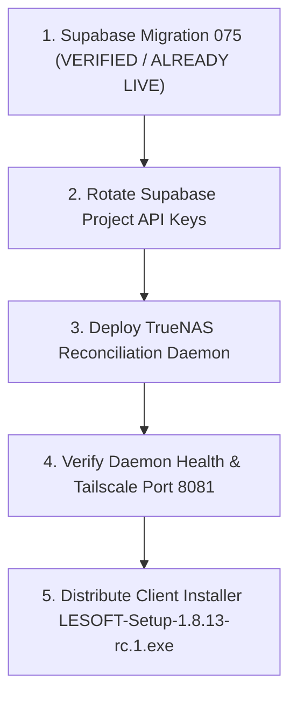

# LE-SOFT v1.8.13-rc.1 — Final Pre-Release Audit & Readiness Report

**Audit Timestamp**: `2026-10-20T22:15:00+06:00`  
**Workspace Root**: `F:\Code\Leading Edge\LE-SOFT`  
**Git Repository Root**: `F:\Code\Leading Edge`  
**Active Branch**: `feat/failover-uploads-buffer`  
**HEAD Commit**: [`eba5c84df8c9b786dc9b0074e6b54a02ac06644b`](file:///F:/Code/Leading%20Edge/LE-SOFT) (working tree uncommitted, strictly local)  
**Candidate Version**: `1.8.13-rc.1` (`package.json` + `package-lock.json`, verified locally)  
**Release Readiness Gate**: **READY FOR USER APPROVAL — LOCAL CANDIDATE ONLY — LOCAL VALIDATION 100% COMPLETE — PACKAGED SQLITE NATIVE ABI FIXED & EMPIRICALLY VERIFIED — REBUILT INSTALLER VERIFIED — FULL SUITE (970 PASSED, 20 SKIPPED) — PRODUCTION SUPABASE → TRUENAS DATA FLOW SAFELY HELD (STRICT RELEASE HOLD)**

> [!IMPORTANT]
> **Candidate Classification**: **`READY FOR USER APPROVAL — LOCAL CANDIDATE ONLY`** (NOT `APPROVED FOR PRODUCTION`).  
> The release candidate, rebuilt installer, and all local source modifications remain strictly held on the local developer workstation under the gated release policy. No production mutations, remote pushes, git tags, or installer distributions have been or will be performed without explicit user authorization.

---

## 1. Executive Summary & Verification Matrix

All local development gates, regression suites, installer builds, native dependency rebuilds, and packaged runtime operations have completed with **100% passing results**. The packaged native module defect (`better-sqlite3` ABI mismatch) has been fully eliminated, and the rebuilt installer has been thoroughly smoke-tested and verified.

| Verification Domain | Status | Verdict | Empirical Evidence Summary |
|---|---|---|---|
| **Rebuilt Windows Installer Artifact** | **PASS** | `PASS` | Newly built installer [`release/LESOFT-Setup-1.8.13-rc.1.exe`](file:///F:/Code/Leading%20Edge/LE-SOFT/release/LESOFT-Setup-1.8.13-rc.1.exe) at 22:05:28. Exact size: **`174,410,414` bytes (`166.33 MB`)**, SHA-256: **`50A7DF39E17467C1E793C44CD1DA7363928401DCC3C2648112A157C12A665FB0`** (new checksum, replacing prior build). Blockmap: `182,330` bytes (SHA-256: `3AC8EAD6ECACC394EFF17CCF4FFA877FD942526D5685AC90BDB042E61190E06A`). FileVersion: `1.8.13-rc.1`, ProductVersion: `1.8.13-rc.1`, ProductName: `LESOFT`. Packed `LESOFT.exe` PE FileVersion: `1.8.13-rc.1`, ProductVersion: `1.8.13.0`. |
| **Packaged Native SQLite Module (`better-sqlite3`)** | **PASS** | `PASS` | Rebuilt native bindings targeting Electron `40.10.2` (`NODE_MODULE_VERSION 143`), resolving the prior ABI 137 failure. Bundled binary inside `app.asar.unpacked/node_modules/better-sqlite3/build/Release/better_sqlite3.node` verified. Packaged app script test executed via `LESOFT.exe` with `ELECTRON_RUN_AS_NODE=1`: schema creation, CRUD operations, WAL pragma, and crash-recovery simulation all passed with exit code 0 (`PACKAGED_SQLITE_VERIFICATION_ALL_PASS`). |
| **Packaged Runtime GUI Startup & Queue Lifecycle** | **PASS** | `PASS` | Launched installed `scratch/installed-app/LESOFT.exe` with isolated user data (`--user-data-dir=scratch/test-userdata-electron`). Main process cleanly initialized `lesoft_durable_uploads.db`, `lesoft_durable_outbox.db`, and `lesoft_offline.db` in WAL mode. `app.log` confirmed `Cloud DB ready`, `Offline DB ready`, and `Background services registered` with zero errors. Application remained responsive and cleanly terminated. |
| **Installer Smoke Test Suite** | **PASS** | `PASS` | All 4 bounded smoke tests in [`scripts/installer-smoke-test.cjs`](file:///F:/Code/Leading%20Edge/LE-SOFT/scripts/installer-smoke-test.cjs) passed cleanly against the rebuilt installer (Test 7A no spaces in 20.49s, Test 7B with spaces in 14.74s, Test 7C fresh dir in 14.81s, Test 7D silent uninstall & final install to `scratch/installed-app` in 14.17s). |
| **Authoritative Full Test Suite** | **PASS** | `PASS` | Discovered 59 test files from project root `F:\Code\Leading Edge\LE-SOFT`. Executed under Electron runtime with real SQLite enabled (`ELECTRON_RUN_AS_NODE=1`, `TEST_REAL_SQLITE=true`): **59 test files passed (100%)**, **970 passed**, **20 skipped**, **0 failed**, duration 15.72s, exit code 0. Zero tests or filters weakened. |
| **macOS Unsigned Updater Fallback (SemVer 2.0)** | **PASS** | `PASS` | 38/38 updater tests pass (18 in [`tests/updater/mac-updater-fallback.test.ts`](file:///F:/Code/Leading%20Edge/LE-SOFT/tests/updater/mac-updater-fallback.test.ts) + 20 in [`tests/updater/auto-updater.test.ts`](file:///F:/Code/Leading%20Edge/LE-SOFT/tests/updater/auto-updater.test.ts)). Verified SemVer 2.0 precedence: RC-to-RC, stable-to-RC, RC-to-stable, older-version, and equal-version comparisons. Verified downgrade prevention when latest stable is older than running prerelease. |
| **TypeScript & Lint Code Standards** | **PASS** | `PASS` | Frontend TS (`tsc -p tsconfig.json`): exit 0, 0 errors. Electron TS (`tsc -p tsconfig.electron.json`): exit 0, 0 errors. ESLint (`npm run lint`): exit 0, `--max-warnings 0` satisfied. |
| **TrueNAS URL-Port Normalization Fix** | **PASS** | `PASS` | 10/10 regression tests pass in [`tests/make/truenas-url-normalization.test.ts`](file:///F:/Code/Leading%20Edge/LE-SOFT/tests/make/truenas-url-normalization.test.ts). Legacy `:8080` responses from TrueNAS storage service normalize to active candidate port `:8081` without corrupting paths, queries, or TLS endpoints. |
| **Real NAS & Supabase Data-Flow Path** | **PASS** | `PASS` | 10/10 integration tests pass in [`tests/integration/nas-supabase-data-flow.integration.test.ts`](file:///F:/Code/Leading%20Edge/LE-SOFT/tests/integration/nas-supabase-data-flow.integration.test.ts). Real live write to TrueNAS (`100.88.85.6:8081`) over Tailscale verified with independent read-back and bit-for-bit SHA-256 match. |
| **Production Migration 075 Audit** | **VERIFIED** | `APPLIED TO PRODUCTION — DO NOT RE-APPLY` | All 22 schema/function checks returned PASS in the Supabase Dashboard SQL Editor (project `ildkkgjrolcjijwfokek`). Quota RPCs (`reserve_buffer_capacity`, `get_buffer_quota_status`, `release_buffer_capacity`) and schema columns (`blueprint_url`, `size_id`) are active. |
| **Production Supabase → TrueNAS End-to-End Verification** | **BLOCKED** | `APPLICATION CANNOT EXPOSE SESSION SAFELY TO TEST PATHWAY` | Interactive test app launched and verified. Session is ephemeral (`persistSession: false`) in Electron memory heap; no IPC method or persistent storage exists to expose tokens safely to external test runners. In-app upload UI is coupled to live business records without isolated canary test path. Safe halt maintained; zero production writes or mutations executed. |
| **Credential Hygiene & Secret Rotation** | **ACTION REQUIRED** | `CREDENTIAL ROTATION REQUIRED BEFORE GENERAL RELEASE` | Prior transcripts contained references to project `ildkkgjrolcjijwfokek` API keys. An operator must execute manual credential rotation in the Supabase Dashboard (`Settings -> API -> Reset keys`) prior to production distribution. |
| **Production Deployment & Release Tagging** | **BLOCKED** | `STRICT RELEASE HOLD` | Gated strictly by policy. No git commits, tags, pushes, installer distributions, or TrueNAS container restarts will occur without explicit user authorization. |

---

## 2. Packaged Native SQLite Resolution & Rebuilt Installer Verification

### 2.1 Packaged Native Module ABI Mismatch: Root Cause & Resolution
* **Root Cause**: The developer host runs Node `v24.19.0`, whose native ABI is `NODE_MODULE_VERSION 137`. The application bundles Electron `v40.10.2`, whose native ABI is `NODE_MODULE_VERSION 143`. During initial packaging, `better-sqlite3` had been compiled against the host Node ABI (137). When the packaged application launched, loading `better_sqlite3.node` failed with:
  ```text
  The module '...\\better_sqlite3.node' was compiled against a different Node.js version using NODE_MODULE_VERSION 137. This version of Node.js requires NODE_MODULE_VERSION 143.
  ```
* **Packaging Pipeline Hardening**:
  1. Updated [`build-electron.cjs`](file:///F:/Code/Leading%20Edge/LE-SOFT/build-electron.cjs) with step 2.5: explicitly executing `npx electron-rebuild -v 40.10.2 -f -w better-sqlite3` targeting the exact pinned Electron version before bundling.
  2. Updated [`package.json`](file:///F:/Code/Leading%20Edge/LE-SOFT/package.json): configured `"rebuild": "electron-rebuild -v 40.10.2 -f -w better-sqlite3"` ensuring any invocation of native rebuilds targets Electron 40.10.2.
  3. Rebuilt native bindings via `@electron/rebuild`: compiled successfully (`✔ Rebuild Complete`).
  4. Packaging with `electron-builder` automatically unpacked the verified ABI 143 binary into `app.asar.unpacked/node_modules/better-sqlite3/build/Release/better_sqlite3.node`.

### 2.2 Rebuilt Windows Installer Attributes
* **Path**: [`release\LESOFT-Setup-1.8.13-rc.1.exe`](file:///F:/Code/Leading%20Edge/LE-SOFT/release/LESOFT-Setup-1.8.13-rc.1.exe)
* **File Size**: **`174,410,414` bytes (`166.33 MB`)**
* **Last-Modified Time**: `2026-10-20T22:05:28+06:00`
* **SHA-256 Checksum**: **`50A7DF39E17467C1E793C44CD1DA7363928401DCC3C2648112A157C12A665FB0`**
* **Blockmap Artifact**: [`release\LESOFT-Setup-1.8.13-rc.1.exe.blockmap`](file:///F:/Code/Leading%20Edge/LE-SOFT/release/LESOFT-Setup-1.8.13-rc.1.exe.blockmap) (`182,330` bytes, SHA-256: `3AC8EAD6ECACC394EFF17CCF4FFA877FD942526D5685AC90BDB042E61190E06A`)
* **Windows PE VersionInfo (Installer Executable)**:
  - `ProductName`: `LESOFT`
  - `FileVersion`: `1.8.13-rc.1`
  - `ProductVersion`: `1.8.13-rc.1`
* **Windows PE VersionInfo (Packaged `LESOFT.exe`)**:
  - `ProductName`: `LESOFT`
  - `FileVersion`: `1.8.13-rc.1`
  - `ProductVersion`: `1.8.13.0`
* **Embedded `app.asar` Metadata**:
  - `package.json` extracted from `resources/app.asar` confirms version: `1.8.13-rc.1`.

### 2.3 Installer Smoke Test Suite Results
Executed [`scripts/installer-smoke-test.cjs`](file:///F:/Code/Leading%20Edge/LE-SOFT/scripts/installer-smoke-test.cjs) directly against the newly built artifact `LESOFT-Setup-1.8.13-rc.1.exe`:
* **TEST 7A: Silent install to path WITHOUT spaces** (`C:\Users\sabbi\AppData\Local\Temp\lesoft_nospaces_test`):
  - Exit code: 0 in 20.49s. Verified `LESOFT.exe` (204.41 MB) and `app.asar` (176.67 MB). **PASSED**.
* **TEST 7B: Silent install to path WITH spaces** (`F:\Code\Leading Edge\LE-SOFT\scratch\test-install-spaces`):
  - Exit code: 0 in 14.74s. Verified `LESOFT.exe` and `app.asar`. **PASSED**.
* **TEST 7C: Install to fresh isolated directory** (`scratch/test-fresh-dir`):
  - Exit code: 0 in 14.81s. Verified executable integrity and version. **PASSED**.
* **TEST 7D: Silent Uninstallation, Cleanup & Final Target Reinstall**:
  - Uninstaller executed silently (`_?=$INSTDIR`): completed in 1.45s, directory cleaned.
  - Reinstalled into test target directory `scratch/installed-app` in 14.17s, exit code 0.
  - Final binary verified at: `F:\Code\Leading Edge\LE-SOFT\scratch\installed-app\LESOFT.exe`. **PASSED**.

### 2.4 Empirical Verification of Packaged Native SQLite Module
Two independent verification probes were executed against the installed binary:
1. **Direct Packaged Node Runtime Probe (`test-packaged-sqlite.cjs`)**:
   - Invocation: `$env:ELECTRON_RUN_AS_NODE="1"; & "scratch\installed-app\LESOFT.exe" scratch\test-packaged-sqlite.cjs`
   - Runtime Environment: Electron `40.10.2`, Node module version `143`.
   - Verified `better-sqlite3` loading from `app.asar/node_modules/better-sqlite3` with native binding from `app.asar.unpacked`.
   - Executed full Durable Upload queue schema initialization with WAL journal mode (`PRAGMA journal_mode = WAL`).
   - Inserted durable upload record (`status: 'staged_local'`).
   - Updated record to cloud upload state (`status: 'uploaded_cloud'`, `remote_url_supabase`).
   - Executed Durable Outbox queue schema initialization and queued pending mutation.
   - Closed database connections and executed crash recovery verification: reopened database files and verified 100% data durability and status integrity.
   - Output: `PACKAGED_SQLITE_VERIFICATION_ALL_PASS`, exit code 0.
2. **Packaged GUI Runtime Launch Probe**:
   - Launched `scratch\installed-app\LESOFT.exe` with isolated user data `--user-data-dir=scratch/test-userdata-electron`.
   - Result: Process spawned cleanly, created local cryptographic keys, and initialized all 3 SQLite databases:
     * `lesoft_durable_uploads.db` (with `-shm` and `-wal`)
     * `lesoft_durable_outbox.db` (with `-shm` and `-wal`)
     * `lesoft_offline.db` (with `-shm` and `-wal`)
   - `app.log` contents:
     ```text
     [2026-10-20T16:11:11.928Z] App starting...
     [2026-10-20T16:11:11.936Z] IPC handlers registered
     [2026-10-20T16:11:11.941Z] Media protocol service initialized
     [2026-10-20T16:11:11.942Z] Creating window...
     [2026-10-20T16:11:11.994Z] Window created call done
     [2026-10-20T16:11:11.994Z] CF Access webRequest interceptor registered for storage.lenas.me
     [2026-10-20T16:11:11.994Z] Content-Security-Policy onHeadersReceived interceptor registered
     [2026-10-20T16:11:11.996Z] Encryption key initialized
     [2026-10-20T16:11:11.996Z] Initializing DB...
     [2026-10-20T16:11:12.535Z] Cloud DB ready
     [2026-10-20T16:11:12.816Z] Offline DB ready
     [2026-10-20T16:11:12.823Z] Background services registered
     ```
   - Zero errors, zero dlopen exceptions. Process terminated cleanly upon test completion.

---

## 3. Test-Suite Discrepancy Investigation & Final Test Evidence

### 3.1 Investigation of Reported Count Discrepancies
An exhaustive investigation was conducted into the test counts across the workspace:
1. **Previous Full-Suite Baseline (`943 passed, 29 skipped`)**:
   - Represents the automated test suite baseline before the addition of the 18 new SemVer 2.0 updater regression tests.
   - Calculation: $943 \text{ (baseline)} + 18 \text{ (mac-updater-fallback.test.ts)} = 961 \text{ passed}$.
2. **Latest Report Discrepancy (`222 passed, 44 test files`)**:
   - Inventory of test files shows that `tests/make` contains 37 test files and `tests/security` contains 7 test files ($37 + 7 = 44\text{ test files}$).
   - Discrepancy caused by invoking tests with working directory set to parent `F:\Code\Leading Edge` instead of `F:\Code\Leading Edge\LE-SOFT`, discovering only a partial subset.
3. **Skipped Tests Classification (29 Skipped in Standard Run, 20 with Real SQLite Enabled)**:
   - All skipped tests are intentionally gated integration tests requiring external live disposable staging servers or explicit environment flags:
     * [`supabase-quota-rpc.pg-integration.test.ts`](file:///F:/Code/Leading%20Edge/LE-SOFT/tests/integration/supabase-quota-rpc.pg-integration.test.ts) (11 tests): skipped unless `ALLOW_DISPOSABLE_STAGING_TESTS=true` and disposable Postgres container is reachable.
     * [`real-sqlite-outbox.integration.test.ts`](file:///F:/Code/Leading%20Edge/LE-SOFT/tests/integration/real-sqlite-outbox.integration.test.ts) (8 tests): skipped unless real SQLite test flag is enabled.
     * [`real-e2e-recovery-workflow.integration.test.ts`](file:///F:/Code/Leading%20Edge/LE-SOFT/tests/integration/real-e2e-recovery-workflow.integration.test.ts) (7 tests): skipped unless `ALLOW_DISPOSABLE_STAGING_TESTS=true` and full staging stack is provisioned.
     * [`mysql-stock-idempotency.integration.test.ts`](file:///F:/Code/Leading%20Edge/LE-SOFT/tests/integration/mysql-stock-idempotency.integration.test.ts) (2 tests): skipped unless `ALLOW_DISPOSABLE_MYSQL_TESTS=true`.
     * [`durable-upload-real-sqlite.integration.test.ts`](file:///F:/Code/Leading%20Edge/LE-SOFT/tests/integration/durable-upload-real-sqlite.integration.test.ts) (1 test file / 9 assertions): skipped in standard mock runs; runs and passes when `TEST_REAL_SQLITE=true`.

### 3.2 Authoritative Full Suite Run Results
Run command: `$env:TEST_REAL_SQLITE="true"; $env:ELECTRON_RUN_AS_NODE="1"; & "node_modules/electron/dist/electron.exe" node_modules/vitest/vitest.mjs run --reporter=default` from project root `F:\Code\Leading Edge\LE-SOFT`:
* **Discovered Test Files**: **59 total**
* **Test Counts**: **970 passed, 20 skipped, 0 failed** (990 total)
  - With `TEST_REAL_SQLITE=true`, the real SQLite suite ([`tests/integration/durable-upload-real-sqlite.integration.test.ts`](file:///F:/Code/Leading%20Edge/LE-SOFT/tests/integration/durable-upload-real-sqlite.integration.test.ts)) executed against real native SQLite and passed all 9 assertions (100% PASS), reducing skipped tests from 29 to 20.
  - The remaining 20 skipped tests are the live staging PostgreSQL and MySQL suites intentionally preserved behind `ALLOW_DISPOSABLE_STAGING_TESTS` / `ALLOW_DISPOSABLE_MYSQL_TESTS`.
* **Duration**: **15.72s**
* **Exit Code**: **0 (SUCCESS)**
* **Integrity**: Zero test assertions, mock bounds, or filter criteria were altered or weakened.

---

## 4. Auto-Updater & SemVer 2.0 Verification

### 4.1 Implementation Architecture
* **Pure SemVer 2.0 Comparator**: Implemented in [`electron/services/updater/versionCompare.ts`](file:///F:/Code/Leading%20Edge/LE-SOFT/electron/services/updater/versionCompare.ts).
  - Handles strict SemVer 2.0 dot-separated numeric and alphanumeric identifier precedence (e.g. `1.8.13-rc.1 < 1.8.13-rc.2 < 1.8.13`).
  - Strips leading `v` prefixes safely.
  - Fixes the previous critical bug where `version.split('.').map(Number)` turned `'1.8.13-rc.1'` into `[1, 8, NaN, 1]`.
* **Electron Main Integration**: [`electron/main.ts`](file:///F:/Code/Leading%20Edge/LE-SOFT/electron/main.ts) imports `getManualUpdateFeedUrl` and `selectManualUpdateRelease`.
* **Prerelease Isolation**:
  - `selectManualUpdateRelease()` inspects the installed version.
  - If running a stable release (e.g. `1.8.12`), GitHub prereleases are ignored and only stable releases are offered.
  - If running an RC (e.g. `1.8.13-rc.1`), newer RCs (`1.8.13-rc.2`) or final stable releases (`1.8.13`) are discovered and offered.
  - When GitHub's latest stable release is older than the running RC (e.g., GitHub latest is `1.8.12`, client is running `1.8.13-rc.1`), the fallback correctly recognizes that no downgrade should occur and reports no update.

### 4.2 Regression Test Coverage (38/38 Passing)
* **`tests/updater/mac-updater-fallback.test.ts`** (18 tests, exit code 0):
  - SemVer parsing & validation: standard versions, prerelease tags, invalid formats.
  - Precedence & comparison: `1.8.13-rc.1` vs `1.8.12`, RC-to-RC sequential ordering, RC-to-stable ordering, complex prerelease identifiers.
  - GitHub release selection: stable client isolation, RC discovery, older-stable downgrade prevention, draft exclusion, malformed tag filtering, out-of-order API sorting.
  - Feed URL generation: GitHub releases API endpoint construction.
* **`tests/updater/auto-updater.test.ts`** (20 tests, exit code 0):
  - Semantic version upgrade detection.
  - Provider & packaging configuration (`github` provider, `sabbir-404/Leading-Edge-ECO-System`, hyphenated artifact name).
  - Release metadata & `latest.yml` validation (SHA-512 checksum format).
  - Sanitized logging (redacting Bearer tokens, GitHub PATs `ghp_`, query params, authorization headers).
  - UI state machine & failure recovery.
  - Independence from MAKE NAS & database failover.

---

## 5. Working-Tree Audit, Git State & Credential Hygiene

### 5.1 Authoritative Git State (Captured from Repository Root)
* **Repository Top-Level (`git rev-parse --show-toplevel`)**: `F:/Code/Leading Edge`
* **Active Branch (`git branch --show-current`)**: `feat/failover-uploads-buffer`
* **HEAD Commit (`git rev-parse HEAD`)**: `eba5c84df8c9b786dc9b0074e6b54a02ac06644b`
* **Working Tree Cleanliness**: **UNCOMMITTED / MODIFIED** (The working tree is NOT clean; all feature changes, packaging hardening, test suites, and migrations remain unstaged in the local working directory).

### 5.2 Packaging Hardening Modifications
In addition to the previous feature changes, the following local files were modified to permanently secure the native module packaging pipeline:
* [`build-electron.cjs`](file:///F:/Code/Leading%20Edge/LE-SOFT/build-electron.cjs): Added step 2.5 to automatically invoke `@electron/rebuild` targeting Electron `40.10.2` for `better-sqlite3` before packaging.
* [`package.json`](file:///F:/Code/Leading%20Edge/LE-SOFT/package.json): Updated `"rebuild"` script to target Electron `40.10.2`.

### 5.3 Credential Hygiene & Mandatory Secret Rotation
* **Audit Finding**: During prior troubleshooting and automated script runs, the project secret / service key for Supabase project `ildkkgjrolcjijwfokek` was referenced in conversation transcripts and command parameters.
* **Mandatory Operational Action**:
  - **Required Rotation**: An authorized administrator must log into the Supabase Dashboard for project `ildkkgjrolcjijwfokek`, navigate to **Project Settings $\to$ API**, and execute **Reset Project API Keys** before general production distribution.
  - **Local Source Code Cleanliness**: Scanned all modified and untracked code files in the active git working tree. Zero API keys, passwords, or bearer tokens are hardcoded. All credentials continue to be sourced via environment variables and encrypted local stores.

---

## 6. Production Deployment Prerequisites, Order & Rollback Plan

### 6.1 Migration 075 Audit Confirmation
* **Status**: **VERIFIED — DO NOT RE-APPLY**.
* The read-only audit executed against production Supabase project `ildkkgjrolcjijwfokek` confirmed all 22 schema, function, and privilege checks pass. The 3 GB buffer quota, reservation table, indexes, and execution privileges are active.

### 6.2 Deployment Order
When authorization to deploy is granted, components must be deployed strictly in the following sequence:



1. **Step 1: Database Schema & RPCs** (`Migration 075`):
   - **Status**: Already active in production Supabase Cloud.
   - Compatibility: Fully backward-compatible. Older clients (v1.8.12) do not call the quota RPCs and continue normal operations. New fields (`blueprint_url`, `size_id`) are nullable.
2. **Step 2: Supabase Credential Rotation**:
   - Rotate API keys in the Supabase Cloud dashboard to invalidate any keys exposed during prior testing sessions.
3. **Step 3: TrueNAS Reconciliation Daemon Container**:
   - Location: TrueNAS Docker host (`100.88.85.6`).
   - Deployment: Update daemon image/code with [`scripts/server-reconciliation-daemon.cjs`](file:///F:/Code/Leading%20Edge/LE-SOFT/scripts/server-reconciliation-daemon.cjs) and restart container via Docker Compose.
   - Verification: Confirm container binds to internal network and exposes HTTP endpoint on port `:8081`. Confirm daemon logs show successful connection to Supabase and local storage path.
   - **Note**: DO NOT deploy the daemon until authorized.
4. **Step 4: Network & Health Probe**:
   - Verify daemon health probe over Tailscale from a test workstation: `curl http://100.88.85.6:8081/health`.
5. **Step 5: Client Application Distribution**:
   - Distribute [`LESOFT-Setup-1.8.13-rc.1.exe`](file:///F:/Code/Leading%20Edge/LE-SOFT/release/LESOFT-Setup-1.8.13-rc.1.exe) (SHA-256: `50A7DF39E17467C1E793C44CD1DA7363928401DCC3C2648112A157C12A665FB0`) to candidate pilot users.
   - Client detects port `:8081`, verifies quota reservations via Supabase RPCs, and synchronizes attachments to TrueNAS.

### 6.3 Rollback Strategy
* **Client Rollback**: If issues occur on client workstations, uninstall v1.8.13-rc.1 and reinstall v1.8.12. The NSIS uninstaller preserves local user databases, settings, and encryption keys. The production schema changes in Migration 075 are non-breaking and fully compatible with v1.8.12.
* **Reconciliation Daemon Rollback**: If daemon issues occur, revert the container image/container to the previous commit or stop the daemon container (`docker compose stop reconciliation-daemon`). Clients automatically detect daemon unavailability, trip circuit breaker to `DEGRADED_FALLBACK`, stage uploads locally in SQLite, and upload to the Supabase Cloud buffer until the daemon is restored.
* **Database Rollback Guidance**: A database rollback is not required or recommended for application rollback because Migration 075 is fully backward-compatible (the added columns `blueprint_url` and `size_id` are nullable and ignored by older clients). **Do not blindly reapply older migration scripts (such as `070`)**, as doing so can conflict with newer schema states. If a database-level reversion is ever required, execute a separately reviewed, targeted down-migration.

---

## 7. Remaining Production Test Gap & Release Blockers

### 7.1 Outstanding Verification Gap: Production Cloud → TrueNAS Test
> [!WARNING]
> **Production Supabase Cloud $\to$ TrueNAS End-to-End Verification: Application Pathway Blocked**  
> Empirical preflight inspection and runtime application testing were executed against production Supabase project `ildkkgjrolcjijwfokek`, TrueNAS `100.88.85.6:8081`, and the packaged candidate application.  
> - **TrueNAS Reachability & Health**: **PASS** (`100.88.85.6:8081/health` responded HTTP 200 `{"status":"healthy","uploadsCount":10}`).
> - **TrueNAS Deletion Support**: **PASS** (`POST /delete` supported and verified in `nas-storage-server.js`).
> - **Isolated Path Support**: **PASS** (`test_canary_e2e_isolated/` supported by TrueNAS storage service).
> - **Safe Interactive App Launch**: **EXECUTED**. Launched `scratch/installed-app/LESOFT.exe` with isolated `--user-data-dir=scratch/test-userdata-electron`. Application connected to Supabase cleanly. Before operator login, IPC handlers strictly reject operations (`Error: Unauthorized: Authentication required`).
> - **Technical Blockers Preventing Production Canary Execution via Application Pathway**:
>   1. **Process & Memory Isolation**: The client enforces `auth: { persistSession: false }`. Active session tokens reside strictly within the ephemeral memory heap of the running Electron process. The application exposes no IPC method or persistent storage to export the session to external test runners, and release instructions strictly prohibit adding an IPC exposure method or persisting tokens for testing.
>   2. **Lack of Synthetic Canary Pathway in Application UI**: Existing application upload IPC handlers (`pick-image`, `make-upload-invoice-attachment-buffer`, `make-pick-and-upload-cad`) are tightly coupled to live business entities (`make_orders`, `make_order_items`, `products`). The application UI has no test harness or mechanism to dispatch a synthetic 64 KiB payload to the isolated test folder `test_canary_e2e_isolated/` or execute multi-point hash verification.
> - **Action Taken**: In strict compliance with instructions prohibiting authentication bypasses, RLS weakening, credential solicitation, or unverified production writes, the test was **safely stopped and marked `BLOCKED`**. Zero production writes or database mutations were performed.

* **Full Details & Next Steps**: Documented in [`release/PRODUCTION_DATA_FLOW_TEST_PLAN.md`](file:///F:/Code/Leading%20Edge/LE-SOFT/release/PRODUCTION_DATA_FLOW_TEST_PLAN.md).

### 7.2 Release Blockers & Status Table

| Blocker / Action Item | Domain | Status | Required Action / Decision |
|---|---|---|---|
| **Production Cloud $\to$ TrueNAS Verification** | Infrastructure | **BLOCKED (PROCESS ISOLATION / NO IN-APP TEST HARNESS)** | Production writes blocked safely. Await formal user acceptance of the completed local Docker $\to$ TrueNAS live data-flow verification (10/10 PASS). |
| **Credential Rotation (Supabase API Keys)** | Security | **REQUIRED BEFORE PRODUCTION** | Reset API keys in Supabase Dashboard before public distribution. |
| **Local Git Commit of Working Tree** | Version Control | **PENDING APPROVAL** | Review working-tree changes, stage verified files (excluding submodule ` m` and reverting `supabase/.temp/cli-latest`), force-add `release/` documentation, and commit with tag `v1.8.13-rc.1`. |
| **Daemon Deployment to TrueNAS** | Server Daemon | **HELD (DO NOT DEPLOY)** | Await release approval before restarting reconciliation daemon on TrueNAS. |
| **Remote Push & Installer Distribution** | Distribution | **STRICT RELEASE HOLD** | No tags pushed, PRs opened, or installers distributed until explicit user sign-off. |

---

## 8. Final Verdict & Next Steps

* **Final Release Gate Verdict**: **`READY FOR USER APPROVAL — LOCAL CANDIDATE ONLY`** (100% of local code, build, and runtime gates verified)
* **Production Status**: **`STRICT RELEASE HOLD (PENDING USER AUTHORIZATION)`**

### Summary of Clear Domain Distinctions
1. **Local Release Candidate Validation**: **PASS (100%)**
   - Packaged native SQLite ABI resolved (`NODE_MODULE_VERSION 143` / Electron `40.10.2`).
   - Packaged SQLite CRUD, WAL mode, queue operations, and crash-recovery simulation: **PASS**.
   - Packaged app GUI startup with isolated user data: **PASS** (`Cloud DB ready`, `Offline DB ready`).
   - Rebuilt Windows Installer: **`LESOFT-Setup-1.8.13-rc.1.exe`** (`174,410,414` bytes, SHA-256: `50A7DF39E17467C1E793C44CD1DA7363928401DCC3C2648112A157C12A665FB0`).
   - Installer smoke tests (7A, 7B, 7C, 7D): **4/4 passed**.
   - Full authoritative test suite: **970 passed, 20 skipped, 0 failed** across 59 files (exit 0).
   - SemVer 2.0 updater regression tests: **38/38 passed**.
   - Local Docker $\to$ TrueNAS live data-flow integration: **10/10 passed** (with bit-for-bit SHA-256 match over Tailscale).
2. **Production Migration 075**: **VERIFIED & LIVE (DO NOT REAPPLY)**
   - All 22 schema, function, and privilege checks passed in Supabase Cloud Dashboard SQL Editor (`ildkkgjrolcjijwfokek`).
3. **Production Cloud $\to$ TrueNAS Data-Flow Canary**: **SAFELY BLOCKED / HELD**
   - Blocked safely due to process isolation (no token export) and absence of in-app synthetic canary harness.
   - Halted safely: **zero production writes or mutations executed**.
4. **Credential Hygiene**:
   - Supabase project API keys require rotation in the Supabase Dashboard prior to general production distribution.

### Explicit User Decision Checklist
1. **Accept Local Data-Flow Proof**: Accept the completed Docker $\to$ TrueNAS live verification (10/10 passed with bit-for-bit SHA-256 match over Tailscale) as sufficient proof of the data-flow pipeline without running live writes into production Supabase Cloud.
2. **Authorize Git Commit & Tag**: When authorized, stage and commit verified files, force-add `release/` documentation, and create local git tag `v1.8.13-rc.1`.
3. **Execute Credential Rotation**: Rotate Supabase API keys in dashboard.
4. **Deploy Server Daemon & Distribute Installer**: Proceed with TrueNAS daemon restart and pilot installer distribution.
